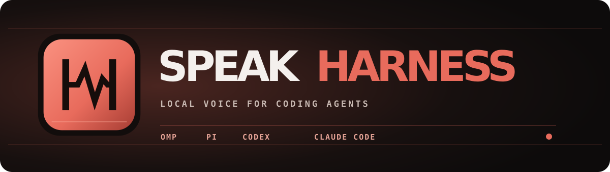
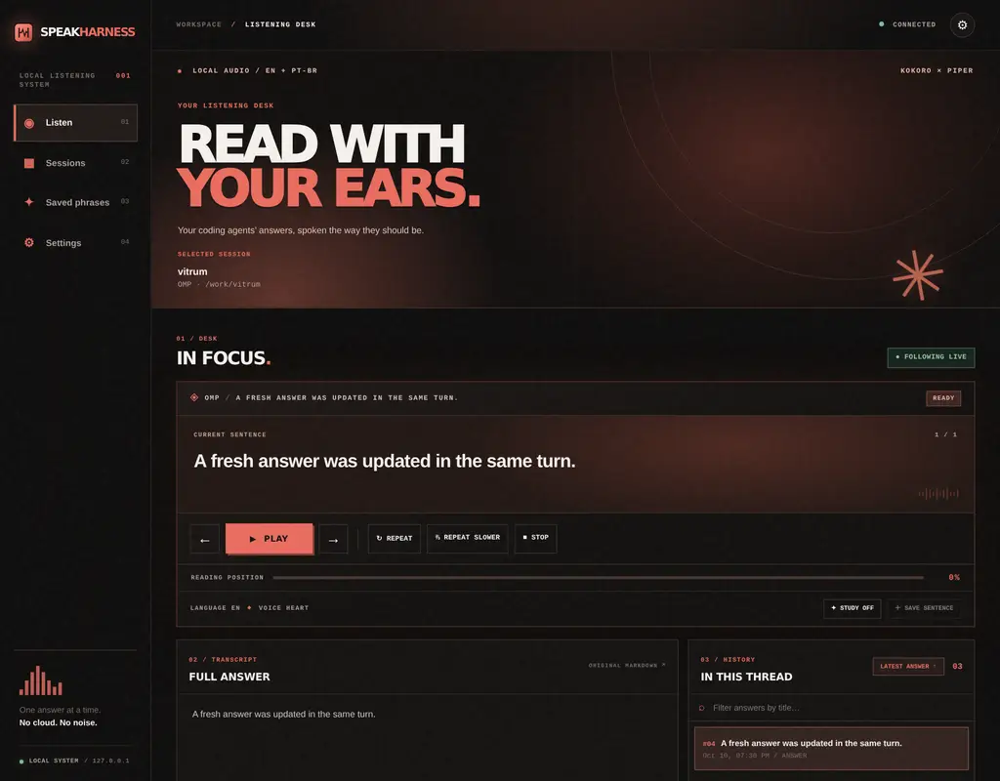
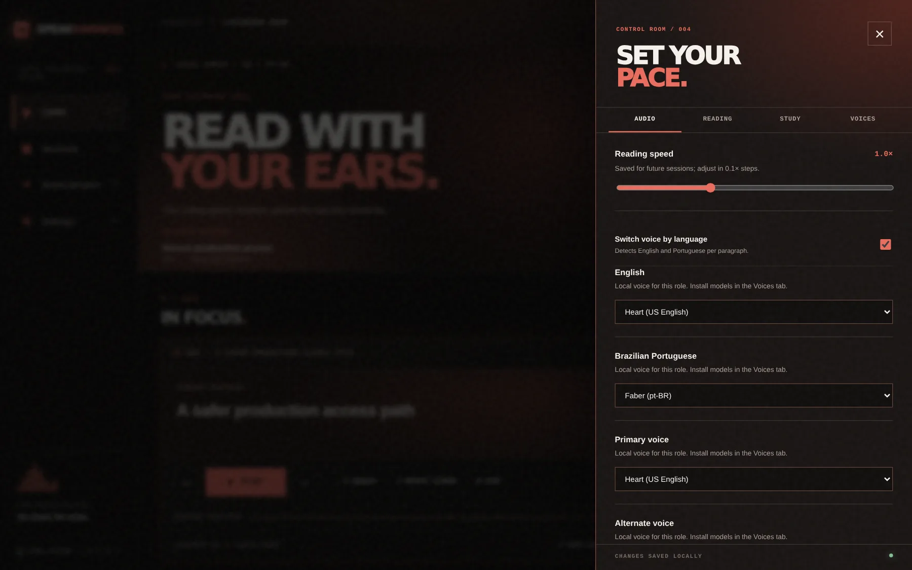
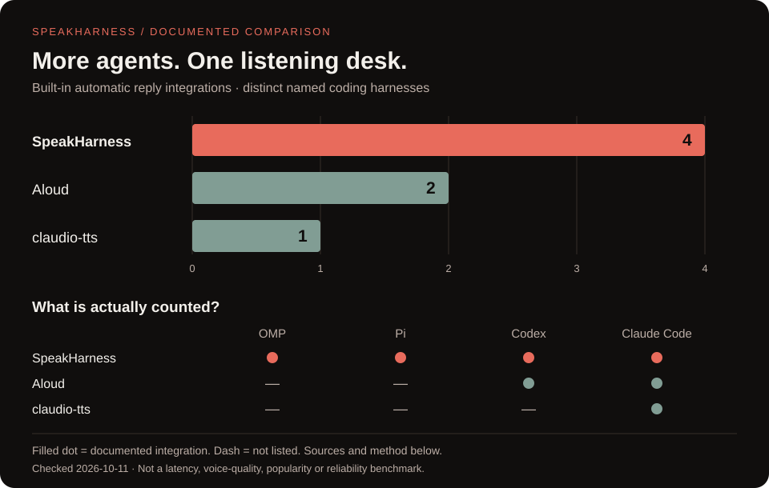

<p align="center">
  
</p>

<h1 align="center">Less scrolling. More listening.</h1>

<p align="center">
  Your coding agents write. <strong>SpeakHarness speaks.</strong><br>
  A native desktop listening desk for OMP, Pi, Codex and Claude Code.
</p>

<p align="center">
  <a href="https://github.com/Matheuscara/speak-harness/releases/latest"></a><br>
  <sub><a href="#quick-start">Windows · Linux · macOS</a></sub>
</p>

<p align="center">
  <strong>Local speech. No TTS account. No per-word bill.</strong><br>
  <sub>English + Brazilian Portuguese · Browser and terminal modes are optional.</sub>
</p>

<p align="center">
  
</p>
<p align="center"><sub>The real listening UI, with a fictional conversation. No personal transcript data.</sub></p>

<table align="center">
  <tr>
    <td align="center"><strong>4 harnesses</strong><br><sub>OMP · Pi · Codex · Claude Code</sub></td>
    <td align="center"><strong>5 desktop targets</strong><br><sub>Native OS/CPU builds verified in CI</sub></td>
    <td align="center"><strong>2 voice languages</strong><br><sub>English + pt-BR, switched per paragraph</sub></td>
    <td align="center"><strong>On your machine</strong><br><sub>Kokoro + Piper synthesis</sub></td>
  </tr>
</table>

<p align="center">
  <a href="https://github.com/Matheuscara/speak-harness/actions/workflows/desktop.yml"></a>
  <a href="https://github.com/Matheuscara/speak-harness/actions/workflows/ci.yml"></a>
</p>

<p align="center">
  <a href="https://matheuscara.github.io/speak-harness/">Website</a> · <a href="#quick-start">Install</a> · <a href="#how-it-compares">Compare</a> · <a href="#supported-harnesses">Supported agents</a> · <a href="#privacy-and-security">Privacy</a>
</p>

## Keep your eyes on the code

<table>
  <tr>
    <td width="33%" valign="top"><strong>Follow the answer</strong><br><br>Pick an existing session. Hear new replies without copying text or restarting your agent.</td>
    <td width="33%" valign="top"><strong>Skip the syntax</strong><br><br>Hear the explanation, not Markdown noise. Code blocks are announced, not recited.</td>
    <td width="33%" valign="top"><strong>Stay with the idea</strong><br><br>Replay a sentence, slow it down, or save a phrase. Read and listen together.</td>
  </tr>
</table>

<p align="center"><strong>Open the app → Choose a session → Press Play</strong><br><sub>Enable “Read new answers automatically” when you want hands-free playback.</sub></p>

<details>
<summary>What the numbers mean — verification and limits</summary>

The v0.2.0 [release build](https://github.com/Matheuscara/speak-harness/actions/runs/38113001768) installed the desktop package, loaded its window and synthesized English and pt-BR speech on **Windows x64, Linux x64/ARM64 and macOS Intel/Apple Silicon**. It did not test physical speakers. The four adapters read each harness's native transcript format; other CLIs need the terminal-capture fallback.

The interface and documentation are in English. Narration switches between English and pt-BR per paragraph. Models download once, then speech runs locally. These are capability counts, not a performance ranking.

</details>

## Quick start

### Desktop installers (no Bun or Node.js setup)

**Download, install, open.** Bun, Node.js and synthesis libraries are bundled. No terminal setup is needed on standard Windows, macOS or glibc Linux desktops.

| Your computer | Download v0.2.0 | Open it |
| --- | --- | --- |
| **Windows x64** | [Installer `.exe`](https://github.com/Matheuscara/speak-harness/releases/download/v0.2.0/SpeakHarness-Setup-0.2.0-x64.exe) | Run the installer, then launch from Start |
| **Linux x64** | [AppImage](https://github.com/Matheuscara/speak-harness/releases/download/v0.2.0/SpeakHarness-0.2.0-linux-x86_64.AppImage) · [Debian/Ubuntu `.deb`](https://github.com/Matheuscara/speak-harness/releases/download/v0.2.0/SpeakHarness-0.2.0-linux-amd64.deb) | Make the AppImage executable, or install the `.deb` |
| **Linux ARM64** | [AppImage](https://github.com/Matheuscara/speak-harness/releases/download/v0.2.0/SpeakHarness-0.2.0-linux-arm64.AppImage) · [Debian/Ubuntu `.deb`](https://github.com/Matheuscara/speak-harness/releases/download/v0.2.0/SpeakHarness-0.2.0-linux-arm64.deb) | Same steps, using the ARM64 build |
| **Mac — Apple Silicon** | [Disk image `.dmg`](https://github.com/Matheuscara/speak-harness/releases/download/v0.2.0/SpeakHarness-0.2.0-mac-arm64.dmg) | Drag SpeakHarness into Applications |
| **Mac — Intel** | [Disk image `.dmg`](https://github.com/Matheuscara/speak-harness/releases/download/v0.2.0/SpeakHarness-0.2.0-mac-x64.dmg) | Drag SpeakHarness into Applications |

> **Before opening:** Windows may show SmartScreen; macOS may require approval in **Privacy & Security**. Windows builds are unsigned; macOS builds are ad-hoc signed, not notarized.

<details>
<summary>First-run downloads, audio requirements and checksums</summary>

Voice models download once: approximately **305 MB for Kokoro q4** and **63 MB for Piper Faber**. Your transcripts remain local. Linux needs a graphical session and a working PipeWire, PulseAudio, ALSA or ffplay player; the app does not configure your speakers.

The [desktop workflow](https://github.com/Matheuscara/speak-harness/actions/workflows/desktop.yml) checks the installed package, window and synthesized speech. [SHA256 checksums](https://github.com/Matheuscara/speak-harness/releases/download/v0.2.0/SHA256SUMS-desktop.txt) accompany the installers.

</details>

<details>
<summary>NixOS: open the native AppImage</summary>

On **NixOS**, run the Linux AppImage with `appimage-run` (the foreign Linux binaries need its FHS environment). For example, after downloading the x64 asset into Downloads:

```sh
nix profile add nixpkgs#appimage-run  # only if appimage-run is not installed
chmod +x ~/Downloads/SpeakHarness-0.2.0-linux-x86_64.AppImage
appimage-run ~/Downloads/SpeakHarness-0.2.0-linux-x86_64.AppImage
```

Use the `arm64` AppImage on ARM64 machines. The native window opens directly; you do not need to run `speakh web` first.

</details>

<details>
<summary>Optional: Nix CLI, browser mode and running from source</summary>

### Nix CLI and browser mode (optional)

```sh
nix profile add github:Matheuscara/speak-harness/v0.2.0
speakh setup       # download the default local voices once
speakh web         # open the optional browser dashboard
```

The Nix flake installs the CLI, browser dashboard and OpenTUI, **not the Electron desktop app**. On Linux, its menu entries open **SpeakHarness** (the browser dashboard) and **SpeakHarness Terminal** (OpenTUI in Alacritty); for the native app, use the installer above. For a one-off browser run without installing: `nix run github:Matheuscara/speak-harness/v0.2.0 -- web`. Use the untagged `github:Matheuscara/speak-harness` flake only if you want the latest `main` instead of a pinned release.

### From source (browser and terminal modes)

Requires **Bun 1.3.14+** and **Node.js 22.18+** for the synthesis subprocess. For speaker playback, Linux needs `pw-play`, `paplay`, `aplay` or `ffplay` on PATH; macOS uses `afplay`; Windows uses the built-in PowerShell audio player (or `ffplay.exe`). The browser dashboard and model synthesis can run without a physical speaker.

```sh
git clone https://github.com/Matheuscara/speak-harness.git
cd speak-harness
bun install --frozen-lockfile
bun src/cli/main.ts setup
bun src/cli/main.ts web  # optional browser dashboard
```

On NixOS, use the Nix CLI installation above rather than running the source directly: it supplies Bun, Node.js and the native library paths needed by ONNX Runtime. The initial downloads are approximately **305 MB for Kokoro q4** and **63 MB for Piper Faber**. Models are cached locally. **Settings → Voices** in the desktop app (or browser dashboard) groups English and Brazilian Portuguese voices: preview installed voices, install missing models, then choose the voice for that language.

</details>

### Already running a harness?

Open the dashboard, go to **Sessions** and choose a conversation. **All** folders are shown by default; use **This folder** to narrow the list to the current project. Turn on **Read new answers automatically** under **Settings → Reading** if you want hands-free playback; it is off by default.

<details>
<summary>Optional: hear OMP replies without opening a window</summary>

### Hear Oh My Pi replies without opening the dashboard

Install the OMP integration once and restart the OMP client so it loads the extension:

```sh
speakh integrate omp
speakh daemon
```

`speakh daemon` is the audio owner when no SpeakHarness interface is open. If `speakh web`, the desktop app or the TUI is already running, keep that one instance instead of starting a second audio owner. The extension sends only final assistant text over a local user-owned Unix socket (or a per-user named pipe on Windows); thinking, tool output and subagent replies are not spoken. A missing SpeakHarness instance never blocks the chat. Remove `~/.omp/agent/extensions/speak-harness.js` to uninstall the integration.

</details>

## What it does

| Capability | Behavior |
| --- | --- |
| Markdown-aware reading | Headings, lists, quotes, tables, links and inline identifiers become natural speech; fenced code is announced by language and line count. |
| Local bilingual voices | Kokoro for English, Piper for pt-BR; manual voice override is available. No cloud TTS or cloud language detection. |
| Live session following | Watches local transcripts and updates the listening page when new answers arrive. A lightweight activity check catches missed live events and indicates when the transcript changed before the next answer. Auto-read still skips thinking, tool results and in-between narration. |
| Native desktop app | Primary graphical listening desk on Windows, Linux and macOS; all-folders session search, Markdown transcript, searchable answer history, playback controls, voice previews and phrase collection. Its service binds only to `127.0.0.1`. |
| OpenTUI | Keyboard-first reader with source-range highlighting, remappable shortcuts and a configurable settings screen. |
| Study mode | Sentence replay, slower repeat, optional shadowing pause and saved phrases. |

<p align="center">
  
</p>
<p align="center"><sub>Voices are grouped by language; previews play in the desktop app or browser and models are installed locally.</sub></p>

## How it compares

SpeakHarness is a **listening companion for coding sessions you already have**, not a microphone interface that requires the agent to change how it works. It can follow an existing OMP, Pi, Codex or Claude Code transcript, turn the final Markdown reply into a speech script, and let you navigate the answer while listening.



**Four agents, one app:** SpeakHarness has **2× the named automatic-reply integrations of Aloud** and **4× those of claudio-tts** in this comparison. That is a coverage count, **not “2× faster” or “4× better.”** If you switch between OMP, Pi, Codex and Claude Code, you can keep the same listening controls instead of changing voice tools.

<details>
<summary>Chart data, sources and counting rules</summary>

| Project | Count | Integrations counted | Source |
| --- | ---: | --- | --- |
| SpeakHarness v0.2.0 | 4 | OMP, Pi, Codex, Claude Code | [Transcript adapters](https://github.com/Matheuscara/speak-harness/tree/v0.2.0/src/adapters) |
| Aloud | 2 | Claude Code, Codex | [README: supported agents and hooks](https://github.com/softcane/aloud#how-aloud-works) |
| claudio-tts | 1 | Claude Code | [README: turn-event integration](https://github.com/restante/claudio-tts#-built-on-claude-code-mods) |

Snapshot: **2026-10-11**. Count one named coding harness with a documented built-in path for automatic spoken replies after enabling it. Hooks, mod events and transcript polling qualify; they are different integration mechanisms, not identical experiences. OMP and Pi count separately because they are separate supported harnesses. Generic terminal capture, manually pasted text and generic MCP compatibility do not count as dedicated automatic integrations.

This chart compares the two direct automatic-reply tools above, **not the entire market**. lisn, VoiceMode and DashVox have different invocation/control models and are discussed below, not assigned a misleading zero. Missing entries mean “not documented in these sources,” not “impossible.” The bars start at zero and use the same scale.

The chart does not measure speech latency, CPU/RAM, pronunciation, reliability or user adoption. Those require an identical-hardware benchmark or user study; we have not run one. For language breadth, claudio-tts advertises **9 voice languages**, while SpeakHarness deliberately supports automatic routing for **English and pt-BR**. More agent integrations does not imply more languages.

</details>

| Product | Coding-agent sources | How speech starts | Reading surface |
| --- | --- | --- | --- |
| **SpeakHarness** | **4** transcript adapters: OMP, Pi, Codex, Claude Code | Optional automatic follow of existing sessions; local English Kokoro + pt-BR Piper, selected per paragraph | Native desktop on **5** OS/CPU targets; browser and OpenTUI also available |
| [Aloud](https://github.com/softcane/aloud) | **2**: Claude Code and Codex | Per-session opt-in; speaks local Kokoro summaries plus questions and approval alerts | macOS daemon, commands and hotkeys; no separate reading window described |
| [claudio-tts](https://github.com/restante/claudio-tts) | **1**: Claude Code | Turn events inside Claude Code; local Kokoro with **9** advertised voice languages | Claude Code slash commands; macOS and beta Windows installers |
| [lisn](https://github.com/Gauravwagh/lisn) | **3** agent integrations via skill/MCP: Claude Code, Codex, Gemini | Agent invokes the reader; local Kokoro or Piper, optional online Edge voices | TUI and browser extension; also reads documents and web pages |
| [DashVox](https://dashvox.ai/) | Claude Code and Codex over SSH | Voice-driven agent sessions with spoken output and verbal approvals; [self-hosted server is free](https://dashvox.ai/pricing) | Phone, watch and CarPlay, rather than a passive local desktop reader |

These are **documented capabilities, not head-to-head performance measurements**. Product descriptions and supported platforms were checked on **2026-10-11** against each linked project's own documentation; an unlisted feature is not proof that it cannot be added. We did not run competitors on identical hardware, so this table makes no speed, speech-quality or reliability ranking. GitHub stars measure reach, not reading quality, and are intentionally not used as a score.

The trade-off is real: Aloud surfaces approval requests that SpeakHarness currently leaves silent; claudio-tts offers more voice languages; lisn reads more document formats; DashVox adds remote voice control. SpeakHarness instead focuses on **passively following four existing coding-harness formats**, bilingual Markdown-aware narration, and a dedicated local reading window. For two-way microphone conversations, [VoiceMode](https://voicemode.dev/) solves a different problem. [Claude's own voice mode](https://support.claude.com/en/articles/11101966-use-voice-mode) speaks in the Claude app, but Anthropic says it is not available as spoken output in Claude Code.

## Supported harnesses

| Source | Existing session? | Reading quality |
| --- | --- | --- |
| Oh My Pi (OMP) | Yes | Native JSONL transcript; original Markdown and message boundaries. |
| Pi | Yes | Native JSONL transcript. |
| Codex | Yes | Native rollout transcript. |
| Claude Code | Yes | Native project transcript; split assistant blocks are merged. |
| Another CLI harness | Start it with `speakh run -- <command>` | Terminal capture fallback: visible text only, with heuristic message boundaries. |
| Markdown file or stdin | `speakh say answer.md` / `speakh say -` | Exact supplied text. |

The capture fallback **cannot attach to an unknown harness that was already running elsewhere**. Add a transcript adapter for that harness or launch it through `speakh run`.

## Controls

**Desktop app (also available in the browser):** use the left navigation to switch between Listen, Sessions, Saved phrases and Settings. Sessions starts at **All** folders; filter by harness, or choose **This folder**. Listen follows new answers without a manual reload; search the thread by answer title or press **Latest answer** to jump back to the newest one. Settings → Voices lets you hear installed voices, install missing ones and choose an English or pt-BR voice. Keyboard shortcuts on Listen include `Space` (play/pause), `←`/`→` (sentences), `r` (repeat), `a` (auto-read) and `s` (stop); `,` opens Settings, `/` opens Sessions and `Esc` returns to Listen from another page.

**Terminal UI:** run `speakh` inside the project directory. The session picker opens first; `Tab` switches between this folder and all folders, `1`–`5` filter harnesses, `/` searches and `a` reveals technical/empty sessions. In the reader, `Space` plays/pauses, `h`/`l` move between sentences, `r` repeats, `t` enables study mode, `p` saves a phrase, `,` opens settings and `?` shows the live keymap. Keys are remappable in the TUI or in the config file.

**Other modes:**

```sh
speakh follow                     # read new answers without an interface
speakh run -- omp                 # run OMP beside an embedded reader
speakh ctl replay-message        # control a running instance from tmux or a script
speakh voices list               # inspect voices and install status
speakh logs                      # recent local warnings and errors
```

In wrap mode, `Ctrl+G` followed by a key sends one reader command. `Ctrl+G →` keeps keyboard focus in the reader; `Esc` or `←` returns to the harness.

## Configuration

Settings are stored in `~/.config/speak-harness/config.toml` (or `$XDG_CONFIG_HOME/speak-harness/config.toml`) on Linux/macOS and `%APPDATA%\speak-harness\config.toml` on Windows. Changes made in the UI are saved and applied live. For example:

```toml
[voices]
primary = "kokoro:af_heart"
alternate = "kokoro:pf_dora"
auto_language = true
speed = 1.0

[voices.languages]
en = "kokoro:af_heart"
"pt-BR" = "piper:pt_BR-faber-medium"

[reading]
auto_read = false
tables = "summary"
```

Audio remains local. On Linux/macOS, saved study phrases live in `~/.local/share/speak-harness/phrases.md` and diagnostics in `~/.local/state/speak-harness/speakh.log` (or the corresponding XDG directories). On Windows, phrases are in `%APPDATA%\speak-harness\phrases.md`, while the model cache and diagnostics are under `%LOCALAPPDATA%\speak-harness`. The desktop lifecycle log is available through its **Open log folder** button.

## Privacy and security

SpeakHarness reads harness session files **without writing to them**. Synthesis, playback and language detection happen locally. The graphical UI binds only to `127.0.0.1`, uses a per-launch key and rejects foreign origins; its Markdown renderer does not execute raw HTML or load remote images. **Installing voice models** downloads those files from their upstream hosts; it does not upload your conversations. SpeakHarness has no hosted account or telemetry service.

## Status, contributing and license

The public [website](https://matheuscara.github.io/speak-harness/) is a static landing page, not an online instance of the app. Its source is in `site/`; `.github/workflows/pages.yml` publishes it with the shared screenshots from `assets/` on changes to `main`. No domain purchase, frontend build or paid hosting is required.

SpeakHarness is an early public release. The [native installer run](https://github.com/Matheuscara/speak-harness/actions/runs/38112663697) passed on **Windows x64, Linux x64/ARM64, and macOS Intel/Apple Silicon**: on each runner it built and installed the desktop app, loaded its window, synthesized English and pt-BR speech through the bundled Node worker, and exited cleanly. The Linux AppImage also opened locally on **NixOS x86_64** through `appimage-run`. Browser mode remains a secondary option and was exercised on **NixOS x86_64** and **Debian x64**. CI checks audio samples and rendering, **not audible playback through physical speakers**; signing/notarization also require maintainer credentials. Packages target glibc Linux desktops, not Alpine/musl; Windows ARM64 is not packaged. Transcript formats can change between harness versions. Please [open an issue](https://github.com/Matheuscara/speak-harness/issues) with a scrubbed sample if an adapter stops recognizing your sessions, or send a PR with a fixture and a behavioral test.

```sh
bun test
bunx tsc --noEmit -p .
```

Original SpeakHarness source is [MIT-licensed](LICENSE). The bundled `ephone` phonemizer is **GPL-3.0-or-later**; redistribution of the combined package must respect that license. Voice models carry their own terms; see [third-party notices](THIRD_PARTY_NOTICES). The project was informed by earlier work on `pi-speak`, but no `pi-speak` implementation was copied into this repository.

[Product plan](docs/PLAN.md) · [Technical design](docs/DESIGN.md) · [Releases](https://github.com/Matheuscara/speak-harness/releases)
